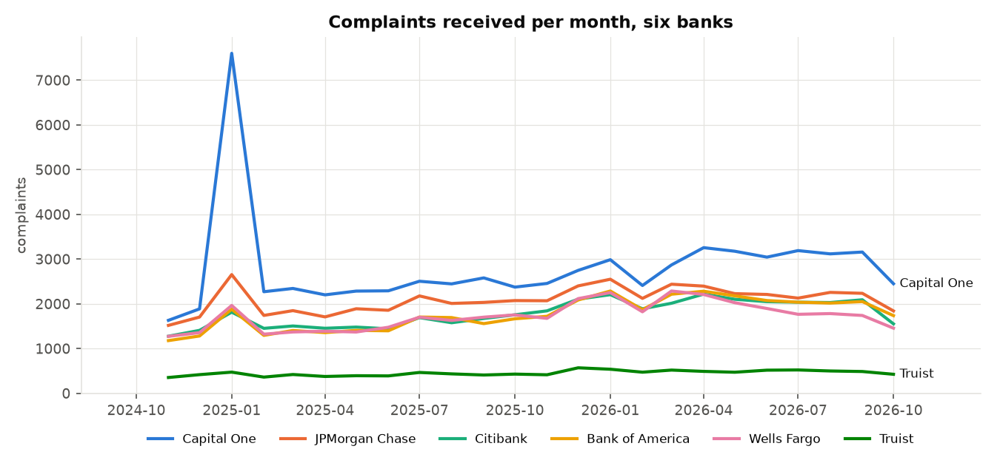
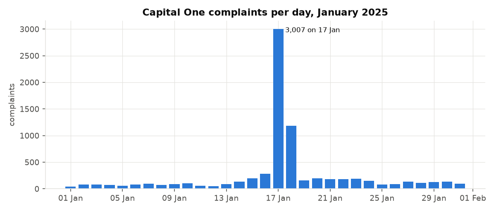

Project Owner & Lead: Titus Robinson Yessaya

AI Development Assistant: Claude (Anthropic)

# CFPB complaint controls

Control testing on two years of real consumer complaints about six large US banks, built the way a risk team would test a complaints process: a pipeline that accounts for every row, a set of control and data-quality tests, an exceptions log, and a Power BI model for an executive risk dashboard.

This is an independent portfolio project. It uses public data only and is not work for any employer or client.

## The data

- Source: [CFPB Consumer Complaint Database](https://www.consumerfinance.gov/data-research/consumer-complaints/), bulk CSV download.
- The file holds the whole database: 18,935,791 complaints, 5.7 GB, latest received date 2026-11-05.
- Scope: Bank of America, Wells Fargo, Truist, JPMorgan Chase, Capital One and Citibank, complaints received 1 Nov 2024 to 31 Oct 2026. That leaves 254,568 complaints.
- The data is real. Every threshold marked **SIMULATED** is my own choice for the exercise. None of them is a regulation or a bank's policy.
- CFPB does not verify complaints. A complaint count says something about consumer experience and reporting, not about a bank's conduct.

## What it does

```
src/pipeline.py   DuckDB SQL cut of the 5.7 GB file, pandas cleaning, cleaning log, star schema
src/controls.py   control tests and the exceptions log
src/report.py     charts and reports/findings.md (aggregates only)
tests/            16 pytest tests on a hand-made fixture
docs/test-cases.md  the same 16 cases written out
powerbi/          measures.dax and BUILD_GUIDE.md for the dashboard
```

Run it:

```
pip install -r requirements.txt
python src/pipeline.py ../data/complaints.csv out
python src/controls.py out
python src/report.py out reports
python -m pytest -v
```

The raw file and `out/` stay local and are git-ignored. Only aggregates are committed.

## Cleaning log

Every row in the source file is accounted for. The pipeline stops if the log does not add up.

| Step | Rows |
|---|---:|
| Rows in source file | 18,935,791 |
| Other companies (excluded) | 18,040,943 |
| Unreadable received date (dropped) | 0 |
| Received outside the review window (excluded) | 640,280 |
| Duplicate complaint IDs (dropped) | 0 |
| **Rows after cleaning** | **254,568** |

18,935,791 - 18,040,943 - 0 - 640,280 - 0 = 254,568. Also flagged but kept: 2,085 rows with no state, and 12 rows where the state was spelled out, recoded to UM.

## Controls

| ID | Control | Threshold | Type | Tested | Exceptions |
|---|---|---|---|---:|---:|
| CTL-01 | Timely response rate by bank and month | at least 98% | SIMULATED | 144 bank-months | 0 |
| CTL-02 | Complaints still in progress after 60 days | over 60 days | from CFPB guidance | 4,047 open | 76 |
| CTL-03 | Routing lag, CFPB to bank | at most 5% of a bank-month over 14 days | SIMULATED | 144 bank-months | 15 |
| DQ-01 | Duplicate complaint IDs | 0 | fixed | 254,568 | 0 |
| DQ-02 | Sent to bank before received | 0 | fixed | 254,568 | 0 |
| DQ-03 | Missing or non-US state | info only | fixed | 254,568 | 2,085 rows (info) |
| DQ-04 | Closed with no timeliness flag | 0 | fixed | 250,521 closed | 0 |
| MON-01 | Monthly volume spike, bank and product | trailing 6-month mean + 3 sd | SIMULATED | 991 series-months | 64 |

The exceptions log (`out/exceptions.csv`, 155 rows) has an exception ID, the control, scope, period, observed value, threshold and type, a root cause read from the data (for example the main issue behind a spike), a suggested remediation action and a remediation status. All statuses are "open" because there is no bank on the other end. The remediation workflow is simulated.

## Key findings

From `reports/findings.md`, which the code writes:

1. **Capital One, 17 Jan 2025:** 3,007 complaints in one day against a January median of 105 a day. Over that day and the next, 3,042 of 4,189 were about "Deposits and withdrawals". It is the biggest event in the window and MON-01 caught it. The data shows the spike, not the cause.
2. **Volume is rising.** The second 12 months had 139,369 complaints, 21.0% more than the first 12 (115,199).
3. **Timeliness passes everywhere.** No bank-month fell below 98%. Bank of America is the lowest at 99.42% and accounts for 234 of the 246 untimely responses in scope. Its weakest month was April 2026 at 98.64%.
4. **Aging:** 76 complaints were still "In progress" after 60 days, 26 of them at Bank of America. Bank of America also holds 1,690 of the 4,047 open complaints (41.8%) while it has 16.6% of the volume.
5. **Routing lag:** 2.6% of complaints reached the bank more than 14 days after CFPB got them. Citibank had 11 of the 15 bank-months over the 5% limit.
6. **Data quality is clean** on the checks run: no duplicate IDs, no reversed dates, no closed complaint missing its timeliness flag.




More charts and the full tables are in [reports/findings.md](reports/findings.md).

## Power BI

`powerbi/measures.dax` has the measures (complaints, timely %, exceptions, month-over-month change, median and average days to company, open over 60 days). `powerbi/BUILD_GUIDE.md` walks through loading the star schema, the relationships, three report pages, and a table of expected values to check the .pbix against the Python numbers.

## Tests

16 tests, all passing. Each one plants a single problem in a small fake file and checks the pipeline or control catches it. The cases are written out in [docs/test-cases.md](docs/test-cases.md).

## Notes from the build

- The download was the whole CFPB database, not a six-bank export: 18.9 million rows and 5.7 GB. Reading it into pandas as text was not going to fit in memory, so the first cut moved to DuckDB SQL running straight on the CSV. Only the six banks come into pandas, and the full pipeline now runs in under 10 seconds.
- The bulk file has fewer columns than the search-page export. It has no narrative, consent or disputed columns, and the first version of the loader refused to run without them. Those three are now optional, and a test covers both layouts.
- The original code handled both ISO dates and the US short format (02/21/25) because the search export uses the latter. The bulk file turned out to be all ISO, so 0 rows were dropped for bad dates. The fallback is still tested.
- The file runs to 5 Nov 2026 but the review window ends on 31 Oct. Ageing open complaints to the last date in the window would have understated their age by 5 days, so CTL-02 uses the latest date in the whole file as the extract date.
- Complaints still "In progress" already carry Timely response = "Yes". Counting them would inflate the timely rate, so CTL-01 and the DAX only use closed complaints.
- The spike monitor needs 6 months of history, so with a window starting in November it could not test anything before May 2025, including the January 2025 spike. The pipeline now keeps monthly counts for the 6 months before the window as a baseline.
- Median days to company is 0 because about 91% of complaints go to the bank the same day. The median on its own hides the lag, so I added the average and the share over 14 days.
- 12 rows had the state written as "UNITED STATES MINOR OUTLYING ISLANDS" instead of a code.
- At 98% CTL-01 found no exceptions. I kept the threshold rather than raising it to manufacture some. The CTL-03 limit of 5% was set after seeing that a typical bank-month runs at about 2.5%, so treat it as a calibrated example, not an independent standard.
- On the monthly chart the four mid-sized banks sit on top of each other, so their end labels collided. Only Capital One and Truist are labelled; the legend covers the rest.
