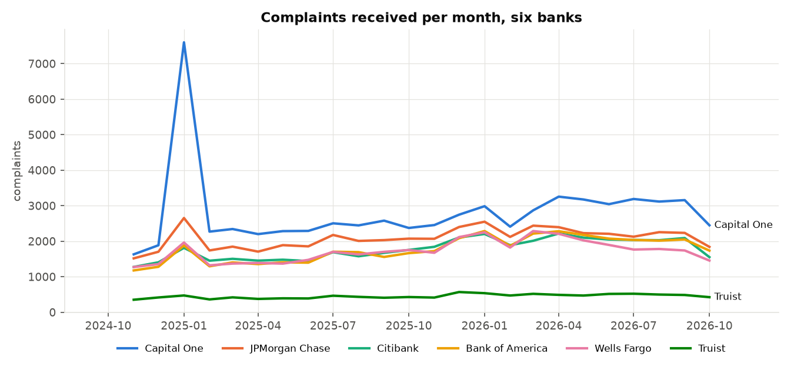
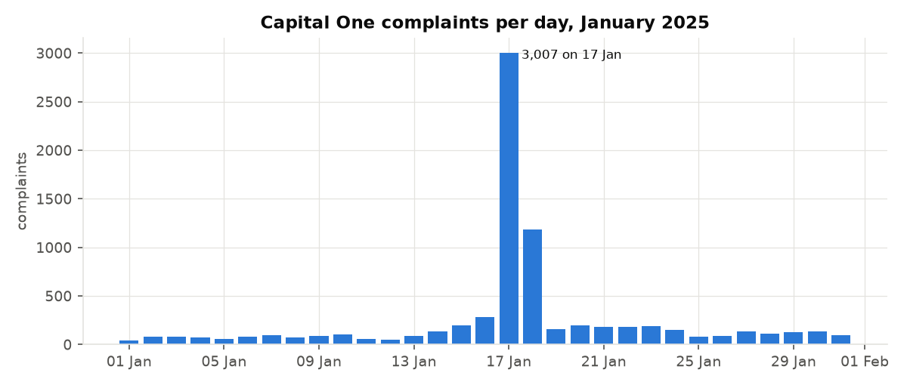
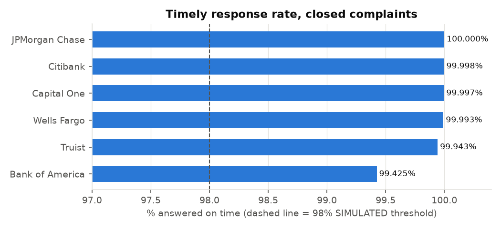
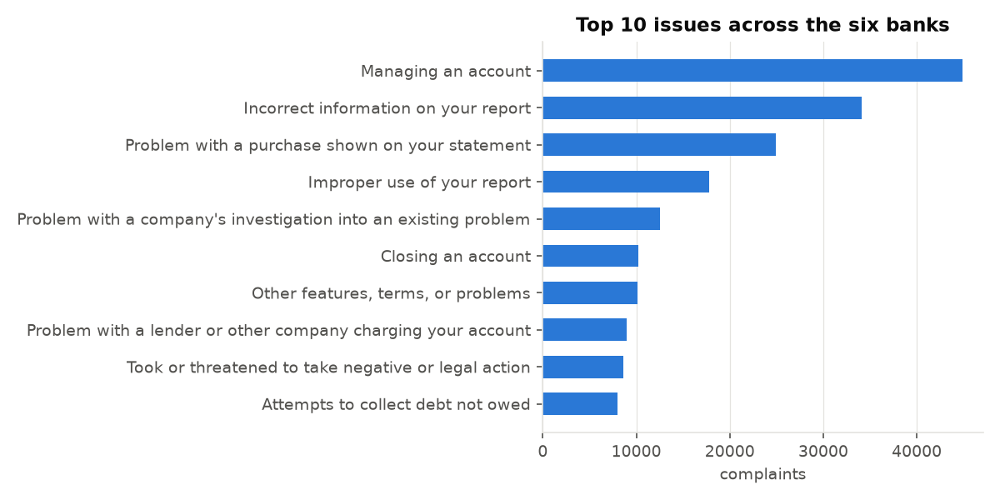
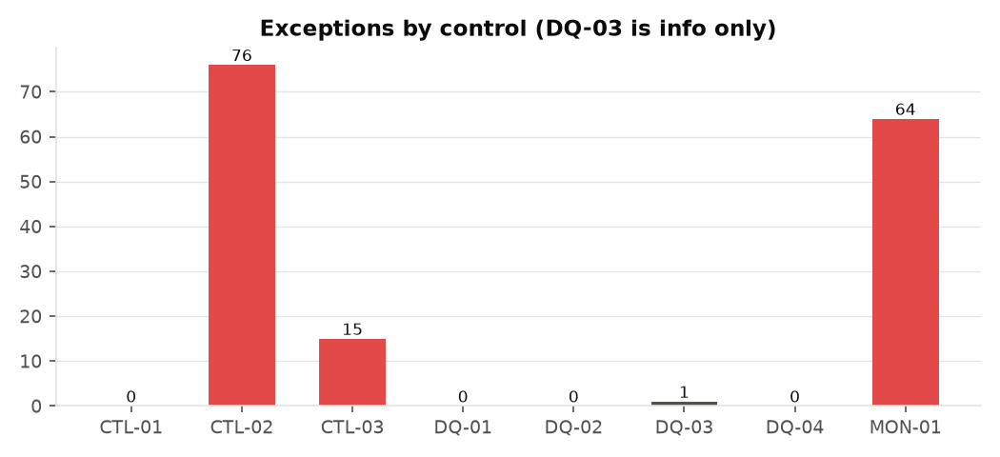

# Findings

Source: CFPB Consumer Complaint Database bulk file (latest received date in file: 2026-11-05). Scope: six banks, complaints received 2024-11-01 to 2026-10-31. Every number here is written by src/report.py from the real file.

Thresholds marked SIMULATED are my own choice for this exercise, not a regulation and not any bank's policy.

## Key findings

1. **254,568 complaints** in scope. Volume in the second 12 months (139,369) was 21.0% higher than the first 12 months (115,199).
2. **Capital One, 17 Jan 2025:** 3,007 complaints in one day, against a January 2025 median of 105 a day. Across that day and the next, 3,042 of 4,189 were sub-issue 'Deposits and withdrawals'. MON-01 flagged it. The data shows the spike, not the cause.
3. **Timeliness passes everywhere (CTL-01).** Every bank-month was at or above 98%. Bank of America is the lowest bank at 99.425% with 234 of the 246 untimely responses in scope. Its weakest month was 2026-04 at 98.64%.
4. **76 complaints still 'In progress' after 60 days (CTL-02)**, out of 4,047 open. Bank of America holds 1,690 of the open complaints (41.8%) with 16.6% of volume. Most open complaints are recent: the median open complaint is 23 days old. By bank: Bank of America 26, Capital One 17, Citibank 13, Wells Fargo 13, Truist 5, JPMorgan Chase 2.
5. **Routing lag (CTL-03):** 6,667 complaints (2.6%) reached the bank more than 14 days after CFPB received them. 15 bank-months broke the 5% SIMULATED limit: Citibank 11, Truist 3, Wells Fargo 1.
6. **Data quality is clean.** No duplicate IDs, no complaint sent before it was received, and no closed complaint without a timeliness flag. 2,085 rows have no state.
7. **MON-01 raised 64 spikes** across 36 bank/product series. 27 of them are in January 2025.

## Cleaning log

| Step | Rows | Action |
|---|---:|---|
| rows in source file | 18,935,791 | count |
| rows for other companies (excluded, out of scope) | 18,040,943 | excluded |
| rows with unreadable received date (dropped) | 0 | dropped |
| rows received outside the review window (excluded) | 640,280 | excluded |
| duplicate complaint IDs (dropped, first kept) | 0 | dropped |
| state names spelled out, recoded to 2-letter code (kept, fixed) | 12 | fixed |
| rows with missing or non-US state code (kept, flagged) | 2,085 | flagged |
| rows with no date sent to company (kept, flagged) | 0 | flagged |
| rows sent to company before they were received (kept, flagged) | 0 | flagged |
| rows after cleaning | 254,568 | count |

## By bank

| company_short   |   complaints |   in_progress |   median_days_to_company |   timely_rate_pct |   not_timely |
|:----------------|-------------:|--------------:|-------------------------:|------------------:|-------------:|
| Capital One     |        67277 |           775 |                        0 |            99.997 |            2 |
| JPMorgan Chase  |        50085 |           227 |                        0 |           100     |            0 |
| Citibank        |        42657 |           333 |                        0 |            99.998 |            1 |
| Bank of America |        42373 |          1690 |                        0 |            99.425 |          234 |
| Wells Fargo     |        41331 |           765 |                        0 |            99.993 |            3 |
| Truist          |        10845 |           257 |                        0 |            99.943 |            6 |

## Biggest products

| product                                                 |   complaints |
|:--------------------------------------------------------|-------------:|
| Checking or savings account                             |        74396 |
| Credit card                                             |        73735 |
| Credit reporting or other personal consumer reports     |        58384 |
| Debt collection                                         |        22709 |
| Money transfer, virtual currency, or money service      |        11726 |
| Mortgage                                                |         5698 |
| Vehicle loan or lease                                   |         5539 |
| Payday loan, title loan, personal loan, or advance loan |         1088 |

## Control results

| control_id   | control                                    | threshold                  | threshold_type   |   population |   exceptions | result     |
|:-------------|:-------------------------------------------|:---------------------------|:-----------------|-------------:|-------------:|:-----------|
| CTL-01       | Timely response rate by bank and month     | >= 98%                     | SIMULATED        |          144 |            0 | pass       |
| CTL-02       | Complaints still in progress after 60 days | > 60 days open             | fixed            |         4047 |           76 | exceptions |
| CTL-03       | Routing lag from CFPB to bank              | <= 5% routed after 14 days | SIMULATED        |          144 |           15 | exceptions |
| DQ-01        | Duplicate complaint IDs                    | 0                          | fixed            |       254568 |            0 | pass       |
| DQ-02        | Sent to bank before it was received        | 0                          | fixed            |       254568 |            0 | pass       |
| DQ-03        | Missing or non-US state code               | info only                  | fixed            |       254568 |            1 | info       |
| DQ-04        | Closed complaint with no timeliness flag   | 0                          | fixed            |       250521 |            0 | pass       |
| MON-01       | Monthly volume spike by bank and product   | mean + 3 sd                | SIMULATED        |          991 |           64 | exceptions |

Population means: bank-months tested (CTL-01, CTL-03), open complaints (CTL-02), rows checked (DQ), bank/product months with enough history (MON-01).

## Charts

